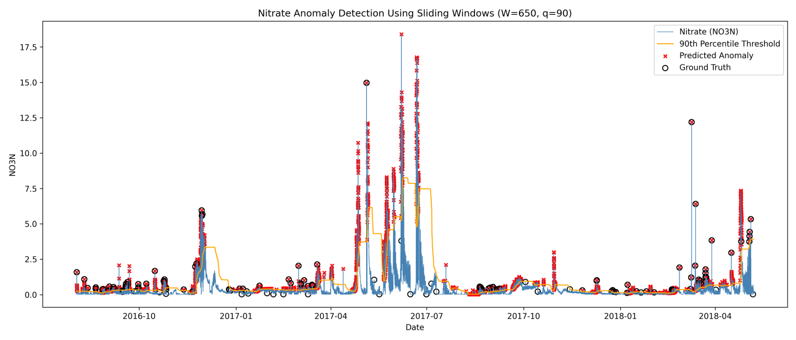

# CSCI 6840 Data Mining — Homework 2

This repository contains my **Homework 2 assignment for CSCI 6840: Data Mining**. The assignment uses a threshold-based anomaly detection method on a nitrate time series with fixed-size, overlapping sliding windows.

## Assignment Method

The implementation uses:

- **Window size (W): 650**
- **Percentile threshold (q): 90**
- **Step size: 1**
- **Detection rule:** upper-tail; a point is labeled anomalous when its value is greater than or equal to the current threshold
- **Percentile calculation:** `numpy.percentile(..., method="linear")`

The program uses the `NO3N` column as the nitrate time series and the `Student_Flag` column as the provided ground truth.

For the first window, the 90th-percentile threshold is calculated from the first 650 observations and all points in that window are labeled using the same threshold. For each following overlapping window, the threshold is recomputed from the current window and only the newly added point is classified.

## Parameter Choice

### Window size: W = 650

A window size of 650 is within the suggested range of 500–2000 observations. The measurements are generally spaced about 30 minutes apart, so the window represents roughly 13.5 days of recent data. This gives the threshold enough recent history while still allowing it to adapt to changes in the nitrate series.

### Percentile: q = 90

The 90th percentile provides an upper-tail threshold that is sensitive enough to detect the required proportion of anomaly events while maintaining the required normal-event accuracy. The selected combination of `W = 650` and `q = 90` meets both assignment performance targets.

## Results

The provided ground truth contains **141 anomaly events**.

| Metric | Result |
|---|---:|
| True Positives (TP) | 107 |
| False Positives (FP) | 4,461 |
| False Negatives (FN) | 34 |
| True Negatives (TN) | 26,188 |
| Normal event detection accuracy | 85.44% |
| Anomaly event detection accuracy | 75.89% |

The required accuracy calculations are:

- **Normal accuracy:** `TN / (TN + FP) = 26188 / 30649 = 85.44%`
- **Anomaly accuracy:** `TP / (TP + FN) = 107 / 141 = 75.89%`

These satisfy the assignment targets of at least 80% normal accuracy and at least 75% anomaly accuracy.

The total of **141 anomalies is used only for evaluation**. It does not affect the sliding-window calculation, percentile threshold, window size, or prediction logic.

## Figure



The blue line is the nitrate (`NO3N`) time series, the orange line is the adaptive 90th-percentile threshold, red `x` markers are predicted anomalies, and black circles are the provided ground-truth anomalies.

## Repository Files

- `HW2.py` — Python implementation
- `AG_NO3_fill_cells_remove_NAN-2.csv` — dataset used by the program
- `anomaly_detection.png` — generated anomaly-detection figure
- `README.md` — assignment description, parameter rationale, and results

## Requirements

- Python 3
- pandas
- NumPy
- Matplotlib

Install the required packages with:

```bash
pip install pandas numpy matplotlib
```

## Running the Program

Keep `HW2.py` and `AG_NO3_fill_cells_remove_NAN-2.csv` in the same directory, then run:

```bash
python HW2.py
```

The program prints TP, FP, FN, TN, normal accuracy, and anomaly accuracy, and saves the figure as `anomaly_detection.png`.
